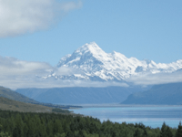
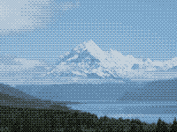

Alters an image's colors to use only colors from a given palette.

   - `Palette` — A list of colors to allow in the output image.  You can either provide a fixed list of colors, or dynamically generate it using `Make Palette from Image`.  For colors where there's no exact match in the palette, this node tries to find the most similar color (the color with the lowest RGB geometric distance).
   - `Palette-Matching Accuracy` — How hard to try when matching colors to the palette.  At 1, this node will try to find the closest match among all palette colors.  At lower values, it will stop when it finds a good-enough match, even if a better match might exist later in the palette.  Lower values can improve performance when working with large palettes.
   - `Dithering` — When reducing a many-colored image to fewer colors, you may see "banding" artifacts where formerly-gradual color changes become solid regions.  This port controls how to compensate for that:
      - **White Noise** — randomly brightens or darkens colors in the input image, producing a rough scattering effect.
      - **Gradient Noise** — uses a periodic pattern to brighten or darken colors, producing a smoother scattering effect.  The number (0.05, 0.02, 0.01) represents the width of one noise period, in Vuo Coordinates.
      - **Bayer** — uses a pattern to brighten or darken colors, producing a thatched or crosshatched effect.  The number represents the pattern's tile size (e.g. for `2x2`, the pattern repeats every 2 pixels on the X and Y axes).  These patterns are designed to produce uniform textures, minimizing periodic artifacts, as described in Bryce Bayer's 1973 paper, "An Optimum Method for Two-Level Rendition of Continuous-Tone Pictures".
      - **Error Diffusion** — takes the difference ("error") between the original color and palettized color, and applies that difference to pixels elsewhere in the image.  The options refer to different ways to distribute that error — how far and in which direction(s) from the source pixel, and the relative weight of each destination.
   - `Dithering Intensity` — How much of the above dithering to apply to the image.  At 0, the image's colors are matched to the palette without any dithering.

Thanks to [Gisle Martens Meyer](https://community.vuo.org/u/gmm) for funding development of this node!

Thanks also to Lee Daniel Crocker, Paul Boulay, and Mike Morra for their [1991 overview article on dithering](http://www.textfiles.com/computers/dhalf.txt).
